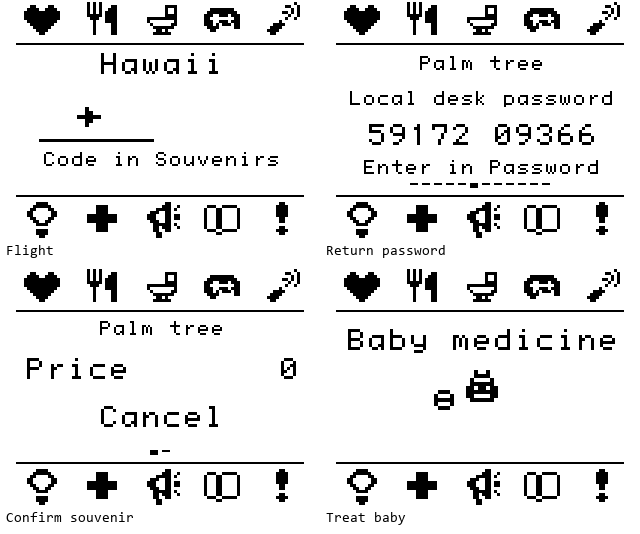
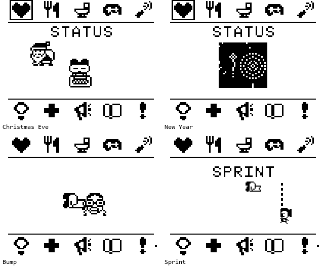
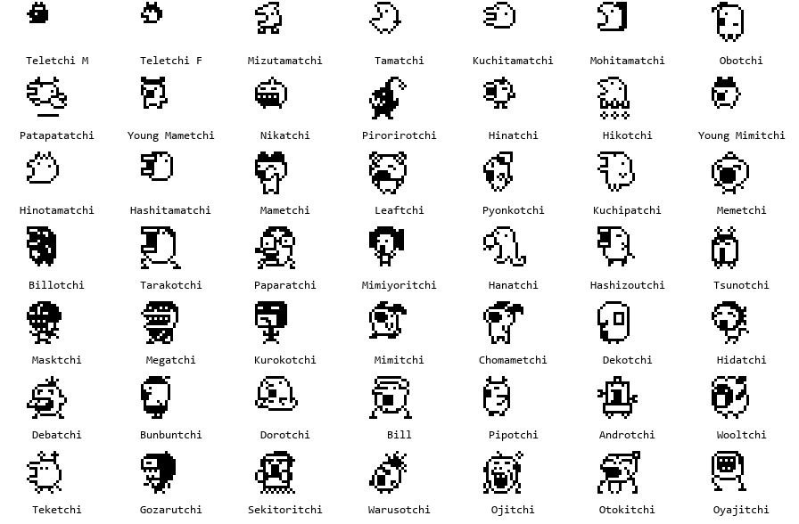

# MochiPod V3

在 iPod Classic 上，从一颗蛋开始养育 2006 年美版 **Tamagotchi Connection V3** 的角色。滑动 Click Wheel 选择照料动作，玩六款小游戏，等媒人来访，再把下一代养大。MochiPod 是社区开发的非官方 Rockbox 游戏插件。

**当前版本 1.0.0-rc.3** · iPod Classic 7th Gen · Rockbox 4.0 · 目标 `ipod6g` · 320 × 240

[下载安装 ZIP](https://github.com/colliderkkz/mochipod/raw/refs/heads/main/downloads/1.0.0-rc.3/mochipod-ipod6g-rockbox4.zip) · [独立 .rock 插件](https://github.com/colliderkkz/mochipod/raw/refs/heads/main/downloads/1.0.0-rc.3/mochipod.rock) · [SHA-256 校验清单](downloads/1.0.0-rc.3/SHA256SUMS)

## 游戏画面



*Rockbox Simulator 截图。旅行归来后，在 Souvenirs 查看两段五位密码，再到 Password 输入并领取纪念品。*



*320 × 240 原生渲染画面。节令按游戏时钟触发，小游戏中的角色会随交锋、摔倒和冲线改变姿势。*

## 安装与第一次启动

1. 在已安装 Rockbox 4.0 的 iPod 上确认 `.rockbox/rockbox-info.txt` 显示 `Target: ipod6g`。已有 MochiPod 的玩家先将旧插件及所有 `mochipod-*` 存档复制到电脑。
2. 下载上方 ZIP，解压至 iPod 根目录。包中只有 `.rockbox/rocks/games/mochipod.rock`。若单独下载插件，请把它放到同一位置。
3. 安全弹出 iPod，进入 **Rockbox → Plugins → Games → mochipod**。已有宠物选择 **Continue**；首次游玩从蛋开始。
4. RC.3 兼容 v5–v12 存档，当前格式为 v12 双槽。遇到时间异常提示时，先核对设备时间，再决定如何处理离线时段。

插件大小 **250,288 字节**。插件 SHA-256 为 `a235ba89486c4ae609662b269aaa8c64ac9b285c064508b19570c0c88cb7b566`。

## Click Wheel 操作

| 操作 | Native iPod 默认模式 |
|---|---|
| 顺时针 / 逆时针滑动 | 下一项 / 上一项 |
| 中央键 | 确认、互动 |
| 短按 MENU | 返回上一级，在主画面打开选项 |
| 长按 MENU | 打开退出确认 |
| 播放 / 暂停 | 快速查看状态 |
| 上一曲 / 下一曲 | 小游戏向左 / 向右 |

设置中可切换 **Classic V3**。上一曲、中央键、下一曲分别对应原版 A、B、C。

退出、开始新游戏、替换宠物、捐赠、领取密码奖励和媒人提议的确认画面会标出按键。按中央键选「是」，按 MENU 选「否」。滚轮、上一曲和播放键不会回答。在 **Classic V3** 模式下，下一曲也选「否」。

## 角色与复刻范围

宠物会经历婴儿、幼儿、青少年和成年期。世代、亲本与照顾情况影响成长候选。可体验喂食、训练、给药、睡眠、商店、旅行、家谱，以及 Get、Bump、Flag、Heading、Memory 和 Sprint 六款小游戏。



*49 个身份各有两幅进食画面与 V3 参考图逐像素核对。黑白点阵来源及每个角色采用的动作见[角色动作来源表](docs/fidelity/POSES.md)。*

复刻以 2006 年 Bandai America V3 为基准。组内成长概率、部分疾病阈值、小游戏内部判定与动画时长仍属近似，提示音使用自行合成的音序。旅行返程码可在本地领取；原 TamaTown 网站和掌机间红外通信不在此移植版中提供。原版资料可参阅 [2006 年说明书](https://tamaplanet.com/images/docs/Tama_Manuals/tama_v3.pdf)。

## 开发与验证

游戏使用 C 编写。核心规则在 `src/core`，像素渲染在 `src/render`，存档读写在 `src/storage`。安装 Python 3 和 GCC 后，在项目根目录运行：

```sh
python tools/test.py
```

在 Linux / WSL 中交叉编译时，将 `RB` 指向一份专用的 Rockbox 4.0 源码树。构建脚本会把插件源文件写入该树，需要先准备好 Rockbox 构建依赖和 ARM 工具链。

```sh
ARM_PREFIX=arm-none-eabi- bash tools/build.sh arm "$RB" "$PWD/build/arm"
python3 tools/package.py build/arm/apps/plugins/mochipod.rock build/package
```

RC.3 已通过 Windows、WSL、ASan、UBSan、Rockbox Simulator 和 ipod6g 交叉编译验证。回归包括 1,000 条成长路线、30 天养育回放和模拟器连续四代。此版本保留候选标记，物理滚轮、真实 LCD、音量与耗电仍待真机验收。
